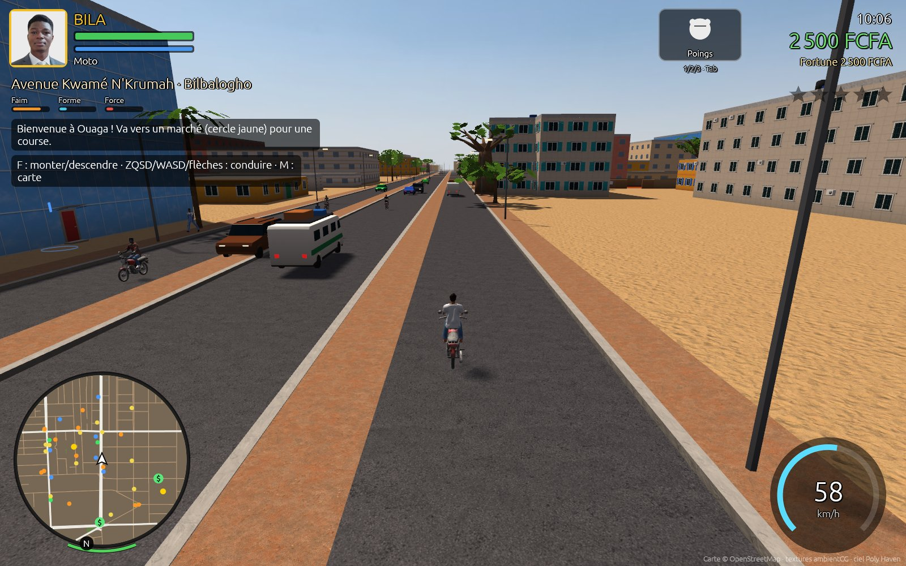
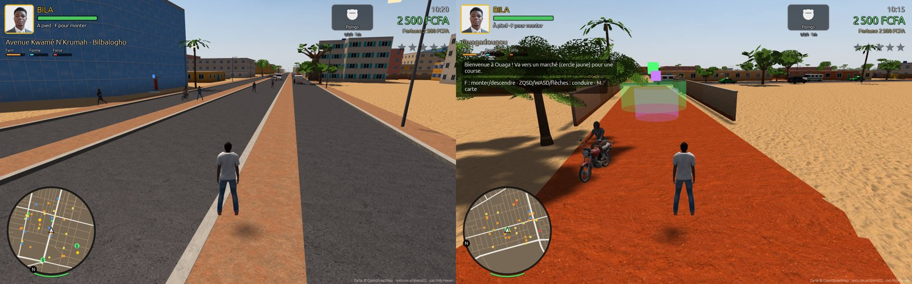
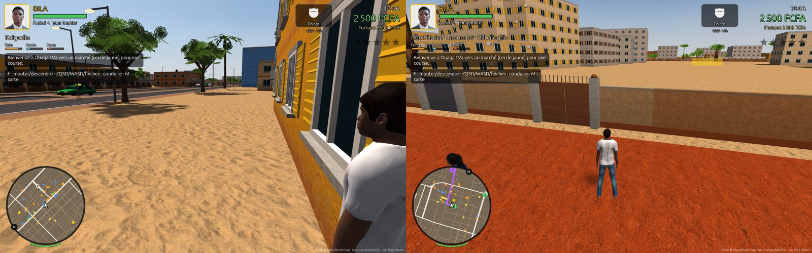
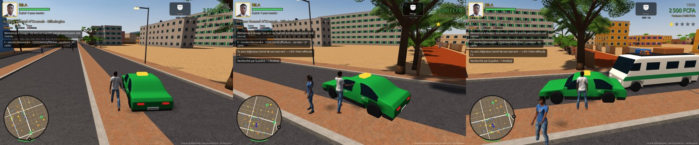
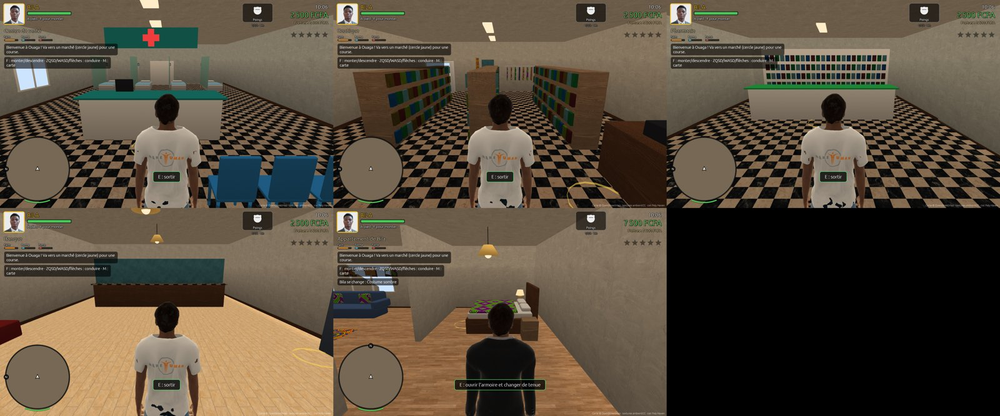
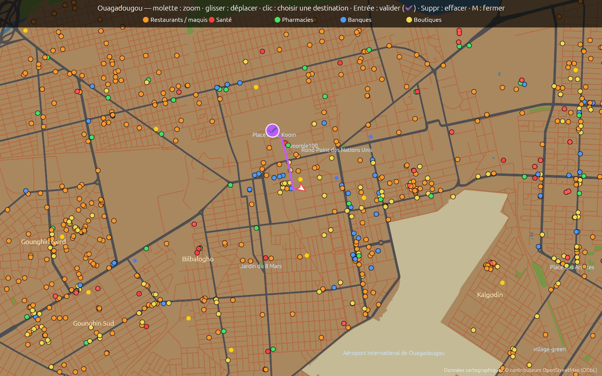

# 🇧🇫 Ouaga City — L'histoire de Bila

**Le rêve ouagalais en monde ouvert 3D.** Parcours les vraies rues de Ouagadougou (Burkina Faso) à moto, en taxi ou à pied, et fais passer Bila de chauffeur de taxi-moto à homme le plus riche d'Afrique.



## ⬇️ Jouer tout de suite (Windows, sans installation)

1. Télécharge **`OuagaCity-v1.0-Windows-portable.zip`** dans la page [**Releases**](../../releases/latest).
2. Décompresse le dossier où tu veux (bureau, clé USB…).
3. Double-clique sur **`OuagaCity.exe`**.

Rien à installer : tout le jeu tient dans un seul fichier. Les sauvegardes vont dans le dossier `sauvegardes` à côté du jeu.

> Windows peut afficher « Windows a protégé votre ordinateur », car le programme n'est pas signé. Clique sur **Informations complémentaires**, puis **Exécuter quand même**.

**Configuration conseillée :** Windows 10/11 64 bits, carte graphique OpenGL 3.3, 8 Go de mémoire.

## 🎮 Le jeu

- **Mode histoire** : 12 chapitres. Le maquis, la flotte de motos, les cars, un hôtel à Ouaga 2000, le Faso Dan Fani, le karité, les télécoms, la banque, l'énergie solaire… jusqu'au sommet.
- **Mode libre**, en solo ou **en ligne** : un joueur héberge, les autres le rejoignent par son adresse IP (port UDP 47777).
- **La vraie ville**, d'après OpenStreetMap :
  - les rues et 108 000 bâtiments ;
  - les monuments (Place des Cinéastes, Nations Unies, Flambeau de la Révolution…) ;
  - les mosquées, les églises et les quartiers.
- **1 457 lieux réels où entrer** : restaurants, maquis, pharmacies, banques, hôpitaux et cliniques, boutiques. On y mange, on s'y soigne, on dépose son argent à la banque et on change de tenue en cabine.
- **Carte et GPS** : on clique sur la carte, on valide, une coche ✔ apparaît. Un itinéraire violet suit ensuite les rues jusqu'au lieu, sur le radar et au sol.
- **Une ville vivante** : chaque passant a un nom, un âge, un métier et une histoire. Les gens discutent entre eux, téléphonent et flânent. La circulation contourne les obstacles, et la police et les gangs réagissent à ce que tu fais.
- **Vie quotidienne** : manger, dormir (sauvegarde), faire du sport pour gagner en forme et en force, parler aux passants, garer son véhicule au garage, changer de tenue dans l'armoire.
- **Conduite** : motos, taxis verts, minibus, pick-up, 4x4, berlines, ambulances. Pour voler un véhicule, Bila ouvre la portière et sort le conducteur.
- **Action** : poings, pistolet, fusil d'assaut, visée à l'épaule, niveau de recherche.
- **Graphismes** : personnages MakeHuman aux mains articulées, textures photo, ombres du soleil, vrais ciels, cycle jour/nuit avec fenêtres éclairées. Les arbres sont modélisés dans Blender : neem, manguier, flamboyant, baobab, palmier.

| | |
|---|---|
|  |  |
|  |  |



## ⌨️ Commandes

| Touche | Action |
|---|---|
| ZQSD / WASD / flèches | marcher, conduire |
| Maj | courir |
| Espace | frein à main |
| F | monter / descendre d'un véhicule (ou le voler) |
| E | entrer, utiliser, acheter |
| T | parler à un passant |
| Clic droit ou V / clic gauche | viser / tirer |
| Tab | changer d'arme |
| Souris (glisser) · molette · C | caméra · zoom · caméra haute |
| M | carte : clic pour choisir, Entrée pour valider le GPS, Suppr pour effacer |
| B | ton empire |
| H | klaxon |
| Échap | pause |

## 🛠️ Compiler soi-même

Il faut [Rust](https://rustup.rs) :

```
cargo run --release
```

Le programme se trouve ensuite dans `target/release/ouaga-city.exe` (un seul fichier, toutes les ressources sont incluses).
Option de test : `--screenshot capture.png` dessine environ 120 images, enregistre une capture et quitte.

### Organisation du code

| Dossier / fichier | Contenu |
|---|---|
| `src/` | le jeu en Rust (eframe/egui + OpenGL) : `r3d.rs` rendu 3D, `game.rs` monde et circulation, `life.rs` intérieurs et vie quotidienne, `gps.rs` itinéraires, `story.rs` histoire, `people.rs` identités des passants, `net.rs` multijoueur |
| `blender/` | scripts Blender qui modélisent les véhicules, les intérieurs, les arbres, le décor des façades, les personnages (MPFB) et leurs squelettes et animations, à lancer avec `blender -b -P <script> -- <dossier>` |
| `tools/` | outils : habitants MakeHuman, texture du feuillage, téléchargement des commerces OSM, conversion image → 3D en local (TripoSR) |
| `assets/` | carte (`ouaga.map`, `buildings.map`, `services.map`), modèles, textures, ciels |

## 📜 Crédits et licences

- **Code** : licence MIT (voir `LICENSE`).
- **Carte, bâtiments, commerces** : © contributeurs [OpenStreetMap](https://www.openstreetmap.org/copyright), licence ODbL.
- **Personnages** : MakeHuman / MPFB (CC0), et portraits générés avec fal.ai.
- **Textures** : ambientCG (CC0). **Ciels** : Poly Haven (CC0).
- **Modèles** (véhicules, intérieurs, arbres, décor) : modélisés pour le jeu dans Blender.

Voir [`CREDITS.md`](CREDITS.md). Ouaga City est un jeu original, sans lien avec aucun autre éditeur de jeux.
